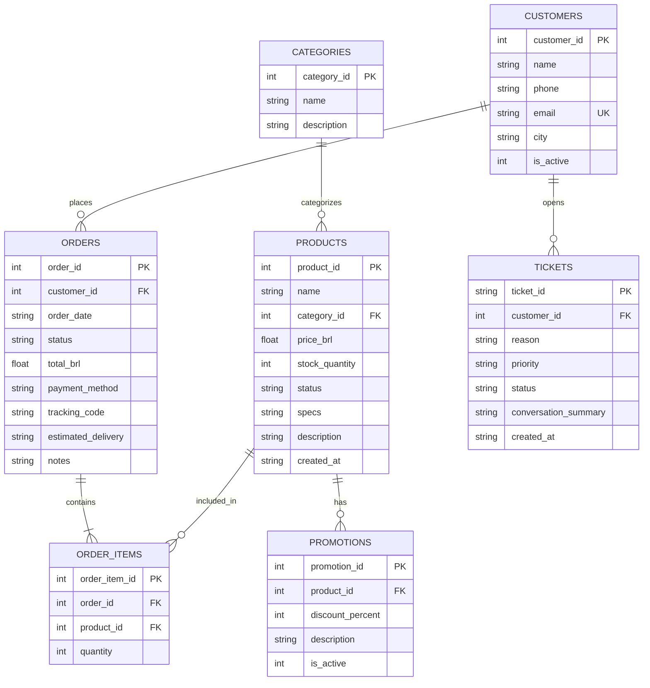

# Arquitetura do Sistema - Ozzy (Empório da Música)

Este documento registra a arquitetura do agente Ozzy, seus fluxos de integração e decisões estruturais.

## Visão Geral

```
Usuário ► UI (Chat Front-end)
             │
             ▼
      FastAPI /chat (Localhost:8000)
             │
             ▼
       Orquestrador (Ozzy)
  Groq API + system prompt + guardrails
             │
             ├────────► Function Calling ───► acionar_atendente() ──► Ticket
             │
             ├────────► buscar_politicas() ──► RAG (ChromaDB local)
             │
             └────────► Ferramentas SQL seguras ──► SQLite (via SQLAlchemy)
```

## Componentes

1. **Front-end:** Interface exportada do Google AI Studio com chat interativo, áudios de demonstração e vitrine de instrumentos.
2. **Backend API:** FastAPI rodando localmente, expondo endpoints de chat, health check e catálogo.
3. **Orquestrador LLM:** Integração com Groq API executando modelo de alta performance com Function Calling.
4. **Base Relacional:** SQLite local para dados estruturados de clientes, pedidos, itens, produtos e promoções.
5. **Base Vetorial:** ChromaDB em disco para busca semântica em políticas e regulamentos da loja.

---

## Modelo de Dados Relacional (SQLite)

Diagrama de Entidade-Relacionamento (ER) implementado via SQLAlchemy em `src/emporio_ozzy/db/models.py`:


